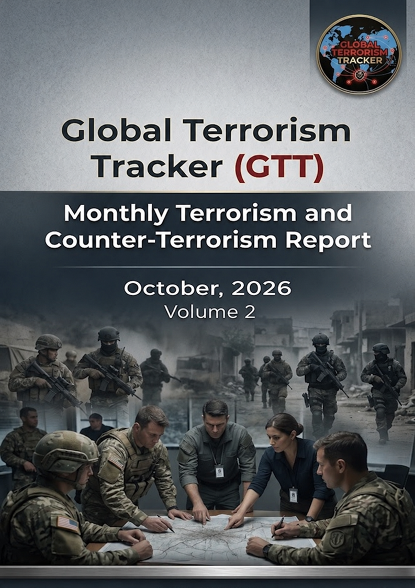
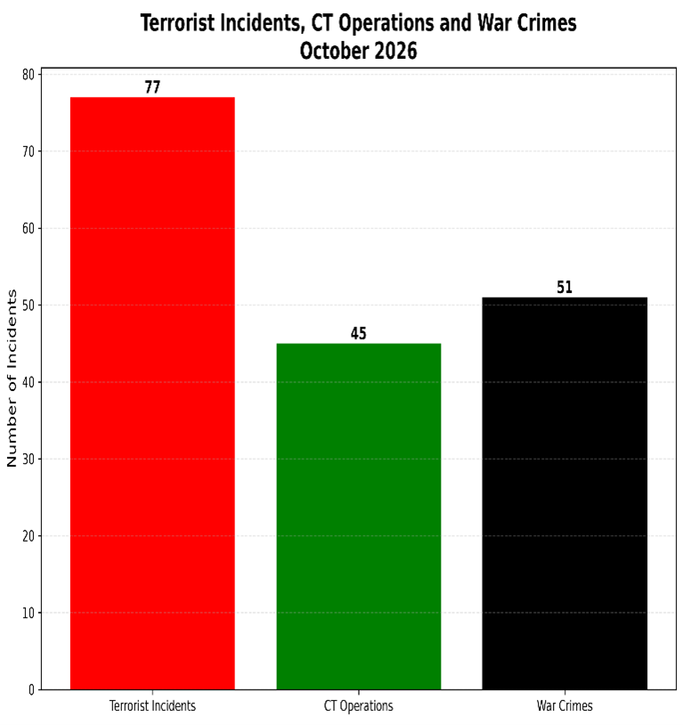
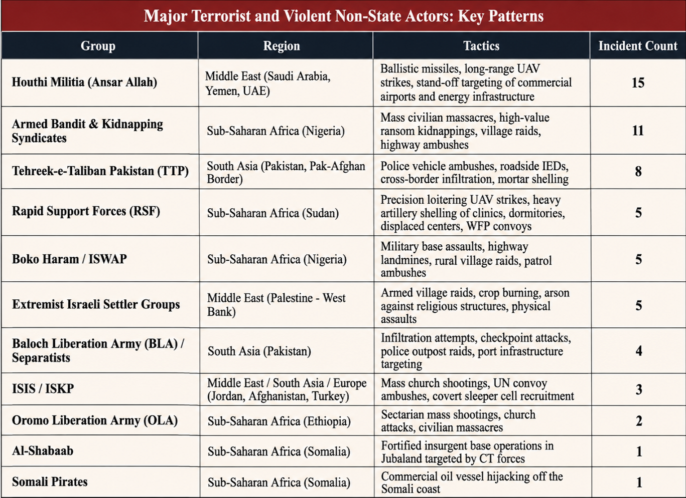
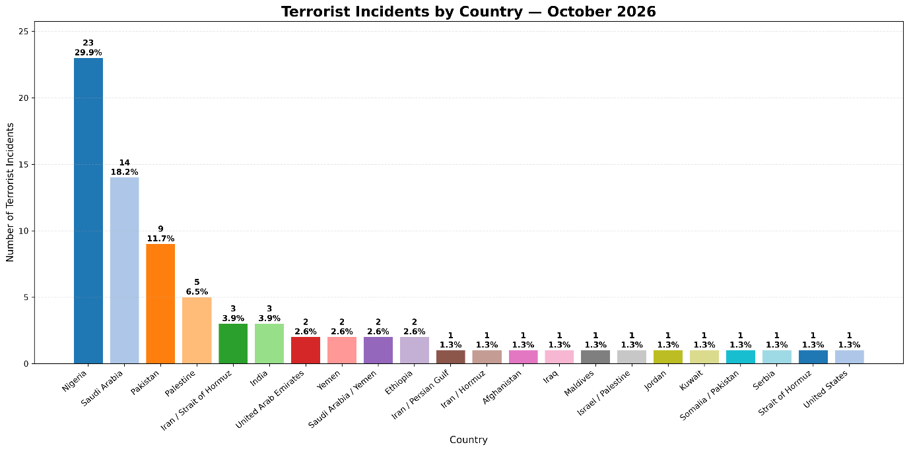
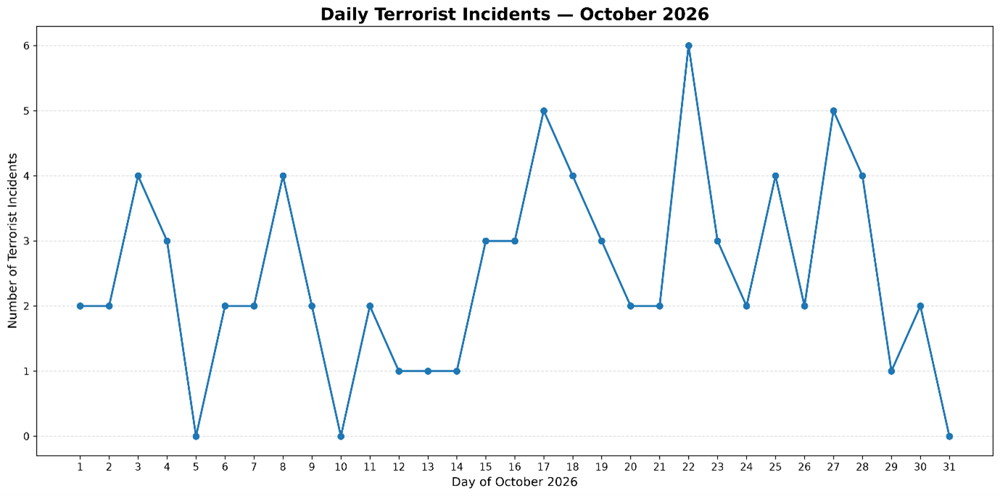
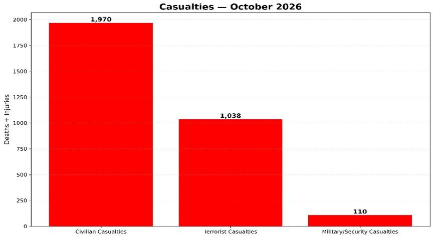

**ABOUT US**

GTT-Global Terrorism Tracker documents and analyses terrorism and security developments around the world through structured reporting, incident tracking, and analytical coverage. The platform provides monthly reporting on terrorist incidents and security operations, alongside analytical coverage of major incidents and developments in terrorism and security.

Copyright © 2026. All Rights Reserved

**Published by:** Syeda Farani Fatima 

**Edited by:** Syeda Farani Fatima

**Contents** 

# Executive Summary	

# Most Active Terrorist Organisations	

# Geographic Distribution of Terrorist Attacks	

## South Asia

## Middle East and North Africa	 

## Sub-Saharan Africa	 

## Isolated Incidents	

# Daily Incident Dynamics

# Major Counter-Terrorism (CT) Operations

# Emerging Technological Trends & Tactics in Warfare

# War Crimes & Targeted Civilian Attacks	

# Recommendations for Global Counter-Terrorism Policy

# Executive Summary

During the October 2026 reporting period, the global security environment was characterized by accelerating asymmetric warfare vectors and widespread non-combatant vulnerability. Tracking incident velocity and casualty metrics is a strategic necessity for identifying emerging threat vectors and anticipating tactical adaptation by non-state actors. Across this monthly period, the Global Terrorism Tracker (GTT) logged a total macro-level dataset of 173 security events globally. This dataset comprises 77 Terrorist Incidents, 45 Counter-Terrorism (CT) Operations, and 51War Crimes. The aggregate human toll across all documented security events reached 3,118 total casualties. This figure comprises 1,970 Civilian Casualties, 1,038 Terrorist Casualties, and 110 Military/Security Casualties. 

Sub-Saharan Africa (notably Nigeria with 23 terrorist attacks, representing 29.9% of global incidents) and South Asia (Pakistan with 9 incidents, or 11.7%) experienced high incident frequency. Terrorist casualties across the dataset were primarily driven by counter-insurgency operations in West Africa and South Asia, alongside state-reported strikes in Yemen. This operational landscape highlights a dual security challenge: non-state groups disrupting energy grids and maritime transit corridors through stand-off technology, alongside widespread disregard for International Humanitarian Law (IHL) in urban conflict zones. 

# Most Active Terrorist Organisations

In October 2026, non-state armed organizations demonstrated distinct operational differentiators tailored to their strategic objectives. 

Houthi Militia (Ansar Allah)prioritized long-range stand-off weaponry, employing ballistic missiles and loitering aerial drones to target commercial aviation hubs and critical energy infrastructure across Saudi Arabia, Yemen, and regional transit corridors. 

Regional insurgents and bandit networks in South Asia and West Africa relied primarily on tactical ambushes, roadside Improvised Explosive Devices (IEDs), village raids, targeted assassinations, and mass kidnappings for ransom. High-lethality paramilitary forces operating within civil war environments, such as Sudan’s Rapid Support Forces (RSF), functioned as non-state armed actors utilizing heavy loitering munitions against civilian infrastructure. In Somalia, maritime security reporting confirmed that the October 4 oil vessel hijacking off the coast was executed by Somali Pirates rather than Al-Shabaab, whose activity was limited to insurgent base operations in Jubaland. 

In Pakistan, TTP and BLA operatives focused on destabilizing law enforcement and security infrastructure in Khyber Pakhtunkhwa and Balochistan through ambushes and border infiltration attempts. 

# Geographic Distribution of Terrorist Attacks

The dataset records a total of 77 terrorist attacks distributed across 22geographic categories. For regional analysis, these incidents can be grouped into South Asia, the Middle East and North Africa (MENA), Sub-Saharan Africa, and Isolated Incidents.

## South Asia

Pakistan recorded 9 incidents(11.7%), followed by India with 3 incidents (3.9%) and Afghanistan with 1incident (1.3%). These attacks primarily involved militant assaults on security posts, law enforcement patrols, and infrastructure, particularly in Pakistan's Khyber Pakhtunkhwa and Balochistan provinces.

## Middle East and North Africa

This region accounted for incidents across Saudi Arabia (14), Palestine (5), Iran / Strait of Hormuz (3), Yemen(2), Saudi Arabia / Yemen (2), and several other locations. These included Iran/ Persian Gulf, Iran / Hormuz, Iraq, Israel / Palestine, Jordan, and Kuwait, each recording 1 incident. The region witnessed Houthi missile and drone campaigns, attacks affecting commercial shipping and energy routes, and other security-related violence.

## Sub-Saharan Africa

Nigeria recorded the highest concentration, with 23 incidents (29.9%), followed by Ethiopia (2), and Somalia/ Pakistan (1). Nigeria's attacks were associated with rural banditry, Boko Haram/ISWAP insurgent activity, and armed kidnapping syndicates operating across several states, including Kebbi, Borno, Benue, Taraba, Oyo, and Plateau.

## Isolated Incidents

The remaining geographically distinct incidents included the Maldives (1), Serbia (1), the United States(1), the United Arab Emirates (2), and the Strait of Hormuz (1). These represent individual incidents outside the three principal regional groupings.

# Daily Incident Dynamics

Across the entire month, the77-attack terrorist dataset indicates a baseline daily average of approximately2.48 attacks per day, reflecting continuous baseline insurgent activity interspersed with concentrated operational surges.

A granular temporal analysis highlights major activity surges throughout the month. The primary operational peak occurred on October 22 with 6 recorded terrorist attacks, characterized by coordinated Houthi ballistic missile and drone strikes on Saudi airports, roadside IED explosions targeting security vehicles in Waziristan, and mass kidnappings and massacres in Nigeria. Secondary activity peaks occurred on October 17 and October 27 with 5 attacks each, alongside notable 4-attackclusters on October 3, 8, 18, 25, and 28. 

In contrast to these high-tempo operational windows, several lull periods were observed, explicitly highlighted by dates with zero recorded terrorist attacks on October 5, October 10, and October 31. 

# Major Counter-Terrorism (CT)Operations

Evaluating state-sponsored counter-terrorism campaigns highlights security force capabilities, intelligence integration, and the systematic degradation of violent non-state networks. State security apparatuses completed 45 major counter-terrorism operations during October 2026. 

In Pakistan, ISPR and Counter Terrorism Department (CTD) forces conducted Intelligence-Based Operations(IBOs) across Khyber Pakhtunkhwa and Balochistan, targeting militant enclaves in Kachhi, Dera Ismail Khan, North Waziristan, Barkhan, Gwadar, Washuk, and Kurram District. 

The Nigerian military executed anti-insurgent air and ground operations across Borno, Kebbi, and Bauchi states, repelling base assaults and striking ISWAP/Boko Haram camps in the Sambisa and Lake Chad basins. 

Turkish security forces executed nationwide raids arresting 51 suspected ISIS members across 16 provinces, while Türkiye’s National Intelligence Organization (MIT) captured high-value ISKP operative Uğur Bahadır (alias Abdullah) in the Afghanistan-Pakistan border region. 

In East Africa, Somali national security forces conducted targeted raids against Al-Shabaab positions in Jubaland, while the Yemeni Armed Forces executed an offensive titled “Dawn of Yemen” in Taiz.

Operational claims released by military authorities, such as the Yemeni Armed Forces claiming 336 Houthis neutralized in 1,087 strikes during “Dawn of Yemen” (October 31) and 512Houthis neutralized in 749 operations (October 23). 

On October 30, Jammu & Kashmir Police dismantled a jail-linked terror financing network supporting Lashkar-e-Taiba (LeT) and The Resistance Front (TRF) in Shopian, arresting 10associates providing logistical and financial support to imprisoned operatives.

Similarly, on October 28, Pakistan’s Federal Investigation Agency (FIA) arrested four key operatives in Karachi involved in human trafficking and terror funding networks. 

Verified kinetic outcomes included over 40 ISWAP fighters eliminated in Borno airstrikes, 12 insurgents killed during border infiltration attempts in Kurram, and successful hostage rescue operations in Edo, Bauchi, and Delta states. 

# Emerging Technological Trends &Tactics in Warfare

During October 2026, operational data highlighted the widespread tactical employment of Unmanned Aerial Vehicles(UAVs/drones), long-range ballistic and cruise missiles, FPV/loitering munitions, Improvised Explosive Devices (IEDs), and subsea naval mines. The strategic threat posed by low-cost loitering munitions and naval mines lies in their ability to impose disproportionate economic disruption. Non-state groups like the Houthi Militia and state proxies such as the IRGC utilize commercial-off-the-shelf and low-cost stand-off vectors to threaten multi-billion-dollar energy infrastructure and international shipping lanes in the Strait of Hormuz, forcing defense forces to expend highly expensive interceptors to counter low-cost saturation attacks.

The Houthi militia in Yemen deployed long-range drone and ballistic missile salvos against commercial airports (King Khalid, King Fahd, Abha, Dammam), Medina power infrastructure, and Saudi Aramco petroleum facilities in Saudi Arabia, causing terminal damage, fuel fires, and civilian casualties. 

In the Russia-Ukraine theater, asymmetric drone and missile warfare targeted electrical power grids, thermal power plants, petroleum refineries (Novoshakhtinsk, St. Petersburg), and strategic transit bridges across Kyiv. 

In Sudan, the Rapid Support Forces(RSF) routinely deployed targeted loitering drones against civilian enclaves, including university dormitories, clinics, and WFP food distribution hubs in Darfur and Khartoum. 

Additionally, subsea naval mines detonated near crude carriers in the Strait of Hormuz highlighted how maritime denial tactics disrupt global energy supply chains. Technological advancements and technical weaponry on the battlefield directly correlate with severe human rights violations and acute civilian protection crises.

# War Crimes & Targeted Civilian Attacks

Data reflected in the graph documents 51 recorded War Crimes and 1,970 Civilian Casualties in October 2026.Precise IHL documentation requires distinguishing state military bombardments from paramilitary strikes in civil conflict zones. 

In Sudan, state military bombardments by the Sudanese Armed Forces (SAF), such as the October 7airstrike on a crowded Khartoum market that killed 18 civilians and injured 25,must be differentiated from paramilitary attacks executed by the Rapid Support Forces (RSF). The RSF conducted deliberate loitering drone strikes and massacres targeting university dormitories in Khartoum, WFP humanitarian convoys, an artisanal gold mining camp near the Egyptian border (killing 72miners), a displaced food center in Darfur (killing over 200 civilians), and a local medical clinic in Nyala (killing 200 civilians).

In Palestine, conflict dynamics revealed severe IHL concerns, including Israeli military strikes on civilian housing and dense refugee camps in Gaza (such as Jabalia, killing 12civilians), university campus demolitions in Gaza City and Birzeit, punitive home demolitions in Hebron (Beita and Ain Deir Baha), forced civilian displacements affecting 1,200 to 2,000 Palestinians, and violent extremist settler raids targeting Palestinian farmers, olive crops, and religious structures. 

In Eastern Europe, Russian military forces conducted extensive strikes on Ukrainian civilian infrastructure, executing daylight attacks on strategic transit bridges across Kyiv's Dnieper River, public passenger buses (killing 30), the central railway station in Dnipro (killing 14), and residential areas in Zaporizhzhia using heavy FAB glide bombs (killing 15). Documenting these systematic violations of International Humanitarian Law underscores the urgent imperative for coordinated global policy interventions.

# Recommendations for Global Counter-Terrorism Policy

Mitigating complex, multi-theater global security threats demands proactive, multi-domain policy frameworks, adaptive defense architecture, and robust multilateral cooperation among international security partners. To address the primary threat vectors identified throughout October 2026, global defense planners must prioritize the rapid deployment of layered anti-UAV Electronic Warfare (EW) defenses and point-defense systems to protect commercial aviation hubs and petroleum infrastructure against low-cost loitering munition saturation attacks. 

Furthermore, international maritime security coalitions must enhance mine-countermeasure operations and vessel escort protocols in critical maritime choke points like the Strait of Hormuz, harden land and sea border surveillance against insurgent infiltration, establish enforced civilian protection protocols under International Humanitarian Law in active conflict zones such as Sudan and Palestine, and bolster international intelligence-sharing networks to dismantle trans-regional terror financing and recruitment networks.

